# INSY7314 POE Part 2
## **HustleHub+ Secure Freelance Marketplace**
### By 
1. Dillon Rinkwest - ST10439147
2. Patrick Shutte - ST10440987
3. Liam Swile - ST10438679
4. Uzair Essa - ST10440109

## Overview
HustleHub+ is a freelance marketplace platform that requires security to ensure the users of the system their data safety especially since this platform is associated with financial data. The platform will be using sensitive information such as user credentials, transactional records, and income related data as the platform will be helping record generated booking financial records as well as help users with indication of incomes earned and estimate tax obligations.
### The Intended User Base
- Clients
- Freelancers
- Administrators of the application

On the HustleHub+ platform freelancers use the platform to advertise their services to clients so that they can get their services booked and achieve financial gain. Clients can browse and gain information on possible services to ensure proper communication on provided services. Admins are there to ensure the proper running of the platform to ensure security and functionality for all users.

### What Part 2 Adds
Part 1 delivered a secure authentication API with users held in memory. Part 2 turns it into the full MERN application:

- **React frontend** - a single-page app built with Vite [1], with a separate dashboard for clients, freelancers and admins.
- **MongoDB database** - Mongoose models for users, gigs, bookings and transactions replace the in-memory store.
- **Domain services** - gigs, bookings with a status workflow and reviews, simulated transactions, and a freelancer income summary with a tax estimate.
- **Access control** - role checks and ownership checks on every protected route, plus admin user management.
- **More security controls** - NoSQL-injection and parameter-pollution protection, HTML stripping, per-endpoint rate limiters, session revocation on password change, and an idle-session timeout.
- **Testing** - a 99-request Postman/Newman collection, backend self-checks, 46 frontend tests, `npm audit` and an OWASP ZAP scan.
- **DevOps** - Docker Compose for the whole stack and a GitHub Actions pipeline.

### What Each Role Can Do

| Role | Features |
|------|----------|
| Client | Browse and view gigs, book a gig, cancel a pending booking, view receipts, review completed bookings, see spending |
| Freelancer | Create, edit, pause and delete own gigs, accept, decline and complete bookings, see earnings and estimated tax |
| Admin | List, search and view users and delete users from the dashboard; view every booking and remove any gig through the API |

Every role can also change their display name and password in Settings.

## Project Structure

```
├── docker-compose.yml         # mongo + api + client containers
├── zap.yaml                   # OWASP ZAP scan plan (report: zap-report.html)
├── .github/workflows/ci.yml   # CI pipeline
├── API/
│   ├── server.js              # HTTPS entry point, secret checks, connects to Mongo, boots the app
│   ├── app.js                 # Express app: middleware pipeline, routes, error handling
│   ├── Dockerfile
│   ├── config/
│   │   └── db.js              # MongoDB connection
│   ├── controllers/
│   │   ├── authController.js      # register, login, logout, profile, password change
│   │   ├── gigController.js       # gig CRUD with ownership checks
│   │   ├── bookingController.js   # bookings, status workflow, reviews, transactions
│   │   ├── incomeController.js    # freelancer income summary and tax estimate
│   │   ├── userController.js      # admin user management
│   │   └── *.check.js             # assert-based self-checks
│   ├── middleware/
│   │   ├── auth.js                # requireAuth (JWT from cookie or Bearer), requireRole (RBAC)
│   │   ├── validators.js          # Input validation for every write endpoint
│   │   ├── sanitize.js            # NoSQL injection, parameter pollution, HTML stripping
│   │   ├── rateLimiters.js        # Global, login, register, booking and password limiters
│   │   ├── securityHeaders.js     # Helmet, CSP, HSTS, no-store
│   │   └── errorHandler.js        # Centralised error responses (no internal leakage)
│   ├── models/
│   │   ├── User.js
│   │   ├── Gig.js
│   │   ├── Booking.js
│   │   └── Transaction.js
│   ├── routes/
│   │   ├── authRoutes.js          # /api/auth
│   │   ├── gigRoutes.js           # /api/gigs
│   │   ├── bookingRoutes.js       # /api/bookings
│   │   ├── incomeRoutes.js        # /api/income
│   │   └── userRoutes.js          # /api/users (admin only)
│   ├── utils/
│   │   └── generateToken.js       # JWT signing
│   └── postman/                   # Part 1 and Part 2 collections, captured Newman run
└── frontend/
    ├── Dockerfile                 # Multi-stage build, served by nginx
    ├── nginx.conf.template        # HTTPS only, security headers
    ├── vite.config.js             # HTTPS dev server, CSP for the built app, Vitest config
    └── src/
        ├── App.jsx                # Session restore, login/register switch
        ├── services/api.js        # API client (cookie auth, safe error messages)
        ├── hooks/useIdleLogout.js # Inactivity timeout
        ├── components/            # Forms, dashboard shell, dialogs, charts
        └── screens/               # One screen per dashboard tab
```

The separation of routes, middleware, controllers and models within their respective folders allow the code solution to have isolated responsibilities to keep logic concise and easy to understand as well as easy to add to bolster the solution. The frontend follows the same idea: screens hold the pages, components hold the reusable parts, and all API calls go through one service file.

## Architecture Diagram

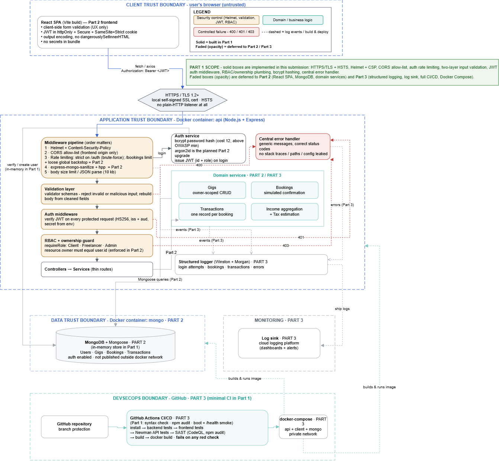

The diagram covers the full MERN design. Part 1 implemented the request pipeline and authentication. **Part 2 implements the boxes that were deferred to it:** the React SPA, MongoDB/Mongoose, `express-mongo-sanitize` + `hpp`, and the domain services (Gigs, Bookings, Transactions, Income/Tax). Docker Compose and the CI pipeline, originally planned for Part 3, are also in place. **Still deferred to Part 3:** structured logging, the cloud log sink, and a real deployment step. The request flow (client → HTTPS → middleware pipeline → validation → auth → RBAC → controllers → services) is identical in every part.

### Request Pipeline
Every request passes through the same middleware, in this order ([app.js](API/app.js)):

```js
app.use(securityHeaders);
app.use(cors({ origin: allowedOrigins, credentials: true }));
app.use(globalLimiter);
app.use(express.json({ limit: "10kb" }));
app.use(noSqlInjection);
app.use(parameterPollution);
```

Routes then add their own checks. Creating a booking, for example, runs authentication, the role check, a per-user rate limiter, HTML stripping and validation before the controller ([routes/bookingRoutes.js](API/routes/bookingRoutes.js)):

```js
router.use(requireAuth);
router.post("/", requireRole("client"), bookingLimiter, sanitizeInput(["note"]), validateBooking, createBooking);
```

## Data Model

Four Mongoose models ([API/models](API/models)):

| Model | Key fields | Security and integrity notes |
|-------|-----------|------------------------------|
| **User** | `name`, `email` (unique, lowercased), `passwordHash`, `role`, `passwordChangedAt` | `passwordHash` is `select: false`, so no query returns it unless it is asked for explicitly. `role` is an enum of `client`, `freelancer`, `admin`. |
| **Gig** | `title`, `description`, `category`, `price`, `deliveryDays`, `active`, `freelancer` | Length and range limits in the schema. `freelancer` is the owner, taken from the JWT and checked on every edit and delete. |
| **Booking** | `gig`, `client`, `freelancer`, `gigTitle`, `price`, `date`, `note`, `status`, `review` | `gigTitle` and `price` are snapshotted at booking time, so a later gig edit or delete cannot change what was agreed. `status` is an enum. |
| **Transaction** | `reference`, `booking` (unique), `client`, `freelancer`, `amount`, `status` | One per booking, enforced by a unique index. `reference` is a random `TX-` code. Payment is simulated. |

A booking moves **Pending → Accepted → Completed**. A freelancer may decline a pending booking and a client may cancel one; either marks the transaction as refunded. A freelancer's income is the sum of their transactions whose booking is Accepted or Completed.

## Security Decisions

Every decision below is driven by the same fact: HustleHub+ handles user credentials, authentication tokens, and financial records (booking income, tax estimates), so the confidentiality and integrity of that data are the priority.

### Password Hashing
Password hashing converts a user's password into a fixed-length, jumbled string that cannot feasibly be reversed [2]. A secure platform never stores passwords in plain text, so that a database breach does not immediately expose every user's password to attackers.

HustleHub+ uses **bcrypt** with a cost factor of 12 ([controllers/authController.js](API/controllers/authController.js)):

`const bcrypt = require("bcryptjs");`

`const passwordHash = await bcrypt.hash(password, SALT_ROUNDS); // SALT_ROUNDS = 12`

**Why bcrypt, and why cost 12:**
- bcrypt is a deliberately slow, *adaptive* hash. The cost factor sets how many key-expansion rounds are run; it can be raised as hardware gets faster without any other code change.
- bcrypt generates and stores a unique random salt per hash, so two users with the same password get different hashes and precomputed "rainbow table" attacks do not work.
- Cost 12 is above the OWASP minimum of 10 [3]. It adds roughly a quarter of a second per hash - unnoticeable to a user logging in, but expensive for an attacker trying millions of guesses.
- `argon2id` (memory-hard, harder to attack with GPUs) remains a possible future upgrade; Part 2 keeps bcrypt, the well-audited, dependency-light choice.

Password hashes are never logged and never returned in any API response. The `passwordHash` field is excluded from every database query by default (`select: false`), and is only loaded for login and password change.

### JWT Authentication
A JSON Web Token (JWT) is a signed, JSON-based token that lets two parties exchange verified claims [4][5]. After login, the API issues a JWT; the client returns it on later requests and the API verifies the signature, so no server-side session store is needed.

**Signing** ([utils/generateToken.js](API/utils/generateToken.js)):
```js
return jwt.sign(
  { sub: user.id, role: user.role },
  process.env.JWT_SECRET,
  {
    expiresIn: process.env.JWT_EXPIRES_IN || "1h",
    algorithm: "HS256",
    issuer: process.env.APP_NAME,
    audience: ["hustlehubClient"]
  }
);
```

**Verifying** ([middleware/auth.js](API/middleware/auth.js)):
```js
const payload = jwt.verify(token, process.env.JWT_SECRET, {
  algorithms: ["HS256"],
  issuer: [process.env.APP_NAME],
  audience: ["hustlehubClient"]
});
```

**Decisions and why:**
- **Minimal payload:** the token carries only `sub` (user id) and `role`. If a token is ever intercepted, no name, email, or other personal data leaks with it.
- **Short-lived:** a 1-hour expiry limits how long a stolen token stays usable.
- **HS256 (symmetric) signing:** the same Express API both issues and verifies tokens - one trusted party, and the secret never leaves the server. Asymmetric signing (RS256) exists so a *separate* service can verify tokens without being able to mint them; there is no such service here, so RS256 would only add key management for no benefit.
- **Algorithm pinned on verify:** `algorithms: ["HS256"]` is set explicitly so the API cannot be tricked into accepting a token signed with `alg: none` or a different algorithm [6].
- **Issuer and audience checked:** every request verifies `iss` and `aud`, not just the signature, so a token minted for a different application is rejected.
- **Mandatory secret:** the server refuses to start if `JWT_SECRET` is missing or shorter than 32 characters ([server.js](API/server.js)), so the signing key can never be weak or absent by accident.

### Session Management
A valid signature alone is not enough. On every request `requireAuth` also loads the user from the database ([middleware/auth.js](API/middleware/auth.js)) [7]:

- **Deleted users are locked out immediately.** If the account no longer exists the token is rejected, even though it has not expired.
- **The role is read from the database, not the token.** `req.user.role` comes from the user record, so a role change takes effect on the next request.
- **Changing a password signs out every other session.** The user record stores `passwordChangedAt`, and any token issued before that moment is rejected. The session that made the change receives a fresh token and stays signed in.
- **Logout clears the cookie on the server.** The cookie is `httpOnly`, so only the API can remove it (`POST /api/auth/logout`).
- **Idle timeout in the browser.** The frontend signs the user out after 15 minutes without activity, with a one-minute warning and a "stay signed in" option [8] ([hooks/useIdleLogout.js](frontend/src/hooks/useIdleLogout.js)). The limit can be changed with `VITE_IDLE_MINUTES`.

### JWT Storage and Transport
On successful register or login the API sets the token in a cookie ([controllers/authController.js](API/controllers/authController.js)):
```js
res.cookie("token", token, {
  httpOnly: true,
  secure: true,
  sameSite: "strict",
  maxAge: 60 * 60 * 1000 // 1 hour, matches the JWT expiry
});
```

**Why an `httpOnly` cookie rather than `localStorage` or a JS variable** [9]**:**
- `httpOnly` means JavaScript cannot read the cookie (`document.cookie` does not see it), so a cross-site scripting (XSS) payload on the page cannot steal the token. A token kept in `localStorage` is readable by any script that runs on the page.
- `Secure` means the cookie is only ever sent over HTTPS, never plain HTTP.
- `SameSite=Strict` means the browser does not attach the cookie to requests that originate from other sites. This closes the CSRF hole that cookies would otherwise open [10], and it is backed up by the CORS allow-list (below).

`requireAuth` reads the token from the cookie first and falls back to an `Authorization: Bearer <token>` header ([middleware/auth.js](API/middleware/auth.js)). The React SPA uses the cookie exclusively: it sends `credentials: 'include'` on every request and never stores or reads the token itself ([services/api.js](frontend/src/services/api.js)). The token is returned in the login/register response body **only when `EXPOSE_TOKEN_IN_BODY=true`** - set for Postman/Newman runs, which have no browser cookie jar. It is off by default, so a normal deployment never puts the token in a response body.

### Access Control
Authentication proves who the user is; access control decides what they may do. HustleHub+ checks both the **role** and the **ownership** of the record, and denies by default [11]. Broken access control is the first item in the OWASP Top 10 [12].

**Role checks** are declared on the route with `requireRole` ([middleware/auth.js](API/middleware/auth.js)), and a wrong role receives `403`:

```js
router.post("/", requireRole("freelancer"), cleanGig, validateGig(false), createGig);   // gigs
router.post("/", requireRole("client"), bookingLimiter, ...);                            // bookings
router.use(requireAuth, requireRole("admin"));                                           // all of /api/users
```

**Ownership checks** are made in the controllers, against the user id from the verified token:
- A freelancer can only edit their own gigs. Only the owner or an admin can delete a gig ([controllers/gigController.js](API/controllers/gigController.js)).
- A booking can only be read or changed by its client or its freelancer; admins may read it. Anyone else receives `404` rather than `403`, so other users cannot probe which booking ids exist ([controllers/bookingController.js](API/controllers/bookingController.js)).
- Each status change is checked against the caller's role: only the freelancer can accept, decline or complete, and only the client can cancel. An invalid transition returns `409`.
- Only the client of a completed booking can review it, and only once.
- The income summary is filtered by the freelancer's id from the token, so a freelancer can never see another freelancer's income.
- An admin cannot delete their own account.

**Values that matter are never taken from the request body.** The owner of a gig, the client and freelancer of a booking, and the price of a booking all come from the token or the database:

```js
const gig = await Gig.create({ ...req.body, freelancer: req.user.id });  // owner from the JWT
price: gig.price, // from the database, never from the request
```

Nobody can register as an admin: registration only accepts `client` or `freelancer`, so an admin account can only be created directly in the database.

The frontend mirrors these rules by showing each role only its own tabs, with an access-denied screen for anything else. This is for usability only; the API is what enforces them.

### CORS
```js
app.use(cors({ origin: allowedOrigins, credentials: true }));
```
The API only accepts cross-origin requests from the configured frontend origin (`CORS_ORIGIN`), and only that origin is permitted to send credentials (the auth cookie) ([app.js](API/app.js)) [13]. Any other website that tries to call the API from a logged-in user's browser is blocked by the browser. Combined with `SameSite=Strict`, a malicious site cannot make authenticated calls on a user's behalf.

### Security Headers
**API** ([middleware/securityHeaders.js](API/middleware/securityHeaders.js)) - Helmet [14] sets the headers on every response:
- **Content-Security-Policy** `default-src 'none'; frame-ancestors 'none'; base-uri 'none'; form-action 'none'`. The API only returns JSON, so it is allowed to load nothing at all [15].
- **Strict-Transport-Security** for one year, including subdomains [16].
- **X-Frame-Options: DENY** and **Referrer-Policy: no-referrer**.
- **Cache-Control: no-store** on every response, so responses containing personal or financial data are never kept by a browser or proxy cache [17].
- Helmet also removes the `X-Powered-By` header, so the API does not advertise that it runs on Express.

**Frontend** ([nginx.conf.template](frontend/nginx.conf.template), and the same headers for `npm run preview` in [vite.config.js](frontend/vite.config.js)):
- **Content-Security-Policy** allowing scripts, styles, fonts and images from the app's own origin only, with `connect-src` limited to the app and the API. Inline scripts are not allowed, which blocks injected script even if markup were to reach the page.
- **HSTS**, **X-Frame-Options: DENY**, **X-Content-Type-Options: nosniff**, **Referrer-Policy: no-referrer** and a **Permissions-Policy** that turns off the camera, microphone and geolocation.
- `server_tokens off`, so nginx does not reveal its version [18].

### Rate Limiting
Five limiters are defined in one place ([middleware/rateLimiters.js](API/middleware/rateLimiters.js)) [19][20]:

| Limiter | Applies to | Limit | Counted per |
|---------|-----------|-------|-------------|
| `globalLimiter` | Every request | 300 per 15 minutes | IP |
| `loginLimiter` | `POST /api/auth/login` | 5 per 15 minutes | IP |
| `registerLimiter` | `POST /api/auth/register` | 10 per 15 minutes | IP |
| `passwordLimiter` | `PATCH /api/auth/password` | 5 per 15 minutes | User |
| `bookingLimiter` | `POST /api/bookings` | 10 per 10 minutes | User |

Login and registration are the endpoints targeted by password brute-forcing and account enumeration, so they get tight limits rather than relying on the global one. The password-change limiter is counted per user, which stops someone with a stolen session from guessing the current password. Booking creation has its own per-user limit because it writes financial records. Read endpoints are cheap and sit behind the looser global limiter.

A blocked request receives `429` with a clear message and the standard `RateLimit` headers. The frontend shows a friendly message and pauses the login button for a short time.

### Input Validation
Input is validated in three layers, so that no single missed check lets bad data through [21].

1. **Middleware** - a validator runs before every controller that accepts a body ([middleware/validators.js](API/middleware/validators.js)). Each one checks the type and content of every field, then **rebuilds `req.body` from the cleaned fields only**, which discards any extra properties an attacker adds. This allow-list approach is the recommended defence against mass assignment [22].

   | Validator | Rules |
   |-----------|-------|
   | `validateRegister` | name 2-50 letters (spaces, `'` and `-` allowed); email checked with `validator.isEmail`, lowercased, max 254; password 8-128 characters with an uppercase, a lowercase and a number; `role` allow-listed to `client` or `freelancer` |
   | `validateLogin` | `email` and `password` only - **login does not take a `role`**; any `role` sent is dropped |
   | `validateProfile` | only the display name can change; email and role are dropped |
   | `validatePasswordChange` | current password required; new password meets the registration rule and must differ |
   | `validateGig` | title 5-80; description 20-500; category from a fixed list; price a number from 50 to 100000; delivery 1-60 whole days. `freelancer` is not on the allow-list, so the owner can never be set from the body |
   | `validateBooking` | a valid gig id; a real `YYYY-MM-DD` date that is not in the past and within a year; note up to 300 characters. Price, client and freelancer are never accepted |
   | `validateStatus` | status must be one of the allowed values |
   | `validateReview` | rating a whole number 1-5; comment up to 300 characters |
   | `validateId` | a malformed id in the URL returns `404` before any database query |

   Any error thrown during validation is caught and returned as `400`, never a `500`.
2. **Controller** - controllers repeat the critical checks as defence in depth. `register` and `login` re-check presence and type and reject non-string values before any lookup ([controllers/authController.js](API/controllers/authController.js)).
3. **Database schema** - the Mongoose schemas repeat the length limits, number ranges and enums ([API/models](API/models)), so invalid data is rejected at the last step even if an earlier check is missed [23].

Body size is capped at 10&nbsp;KB (`express.json({ limit: "10kb" })`, [app.js](API/app.js)) so an oversized payload cannot be used to exhaust memory.

The frontend applies the same rules to its forms and shows a password strength meter, so users get feedback before a request is sent. This is for usability; the API never relies on it.

The principle throughout is **reject by default**: only known-good input shapes are accepted; everything else is refused with a `400` and a specific message [24].

### Injection and XSS Protection
Three sanitisers sit in [middleware/sanitize.js](API/middleware/sanitize.js):

- **NoSQL injection** - `express-mongo-sanitize` runs on every request and removes any key beginning with `$` or containing `.`. A login body such as `{ "email": { "$gt": "" } }` therefore cannot become a MongoDB query operator [25][26]. The validators add a second barrier by rejecting any value that is not a plain string or number.
- **HTTP parameter pollution** - `hpp` runs on every request, so a repeated query parameter cannot be used to pass an array where a single value is expected [27].
- **HTML stripping** - free-text fields (gig title and description, booking note, review comment) have `<script>` and `<style>` blocks removed with their contents, and any other tag removed. The stripping repeats until nothing changes, so a nested payload such as `<scr<script>ipt>` cannot reassemble itself.

Stored text is protected again on the way out: React escapes everything it renders [28], and the Content-Security-Policy blocks inline scripts. A stored XSS payload would have to get past all three, which follows the layered defence OWASP recommends [12][29].

### HTTPS
The API is served **only** over HTTPS ([server.js](API/server.js)) - there is no plain-HTTP listener to downgrade to. `minVersion: "TLSv1.2"` refuses the older, broken TLS versions [30][31]. Helmet adds a `Strict-Transport-Security` (HSTS) header instructing browsers to refuse HTTP for this origin in future.

The frontend is also served only over HTTPS. The Vite dev server reuses the API's certificate, and in Docker nginx accepts TLS 1.2 and 1.3 only and redirects any plain-HTTP request to HTTPS [18].

Because every request carries either credentials (login) or the auth token (cookie), transport encryption is what prevents anyone on the network path - public Wi-Fi, an ISP, a compromised router - from reading or altering that data in transit. Locally the certificate is a self-signed certificate generated with OpenSSL; production would use a CA-issued certificate.

### Error Handling
All errors funnel through one central handler ([middleware/errorHandler.js](API/middleware/errorHandler.js)) [32]:
- the full error and stack trace are written to the **server log only**
- the client always receives a generic `{ "error": "An unexpected error occurred." }` with the correct status code - no stack traces, file paths, dependency names or versions, or configuration are ever returned, so an attacker cannot use error responses to fingerprint the system
- a small set of safe, specific messages is allowed: malformed JSON → `400`, body too large → `413`, unknown route → `404`, invalid identifier → `400`, invalid data → `400`, duplicate value → `409`. Database errors are translated into these messages, so no Mongoose or MongoDB error text reaches the client

Login errors are deliberately vague in the same way: login returns the identical `"Invalid email or password."` whether the email is unknown or the password is wrong ([controllers/authController.js](API/controllers/authController.js)), so the login endpoint cannot be used to discover which email addresses have accounts.

The frontend adds a second layer ([services/api.js](frontend/src/services/api.js)). The API's own `4xx` messages are shown to the user, but any `5xx` response is replaced with a generic message, so server internals never reach the screen. A `401` on a protected request signs the user out with a "session expired" notice.

### Database and Container Security
- **The API will not start without a database.** `MONGO_URL` is required, and the HTTPS listener only opens once the connection succeeds ([server.js](API/server.js)).
- **The database is not reachable from outside.** In Docker, MongoDB sits on an internal-only network with no published port, so only the API container can connect to it ([docker-compose.yml](docker-compose.yml)) [33].
- **The database requires authentication**, with credentials supplied from an untracked `.env` file [34].
- **Containers run with least privilege.** The API image installs production dependencies only and runs as the non-root `node` user. The frontend image is a multi-stage build, so the final image holds only nginx and the built static files [35][36].
- **Secrets are never baked into an image or committed.** Certificates are mounted read-only at run time, environment values come from `.env` files, and `.env` and `certs` are in `.gitignore` and `.dockerignore`.
- **Deleting a user removes their data.** Their gigs, bookings and transactions are deleted with the account, so nothing is left pointing at a user that no longer exists.

## API Endpoints

Authenticated requests are identified by the `token` cookie (set automatically on login/register) or, for API clients, an `Authorization: Bearer <token>` header.

### Health and Auth

| Method | Endpoint | Access | Description |
|--------|----------|--------|-------------|
| GET | `/health` | Public | Basic liveness check |
| POST | `/api/auth/register` | Public | Register - body: `name`, `email`, `password`, `role` (`client` or `freelancer`) |
| POST | `/api/auth/login` | Public | Log in - body: `email`, `password` only (no `role`) |
| POST | `/api/auth/logout` | Public | Clears the auth cookie |
| GET | `/api/auth/me` | Any signed-in user | Returns the signed-in user |
| PATCH | `/api/auth/me` | Any signed-in user | Change display name - body: `name` |
| PATCH | `/api/auth/password` | Any signed-in user | Change password - body: `currentPassword`, `newPassword` |

### Gigs

| Method | Endpoint | Access | Description |
|--------|----------|--------|-------------|
| GET | `/api/gigs` | Any signed-in user | List active gigs |
| GET | `/api/gigs/mine` | Freelancer | Own gigs, including paused ones |
| GET | `/api/gigs/:id` | Any signed-in user | One gig (a paused gig is visible to its owner only) |
| POST | `/api/gigs` | Freelancer | Create a gig - body: `title`, `description`, `category`, `price`, `deliveryDays` |
| PATCH | `/api/gigs/:id` | Freelancer (owner) | Edit a gig, or pause it with `active` |
| DELETE | `/api/gigs/:id` | Freelancer (owner) or Admin | Delete a gig |

### Bookings

| Method | Endpoint | Access | Description |
|--------|----------|--------|-------------|
| POST | `/api/bookings` | Client | Book a gig - body: `gigId`, `date`, `note`. Creates the booking and its transaction |
| GET | `/api/bookings` | Admin | Every booking |
| GET | `/api/bookings/mine` | Client or Freelancer | Own bookings |
| GET | `/api/bookings/:id` | Its client or freelancer, or Admin | One booking |
| PATCH | `/api/bookings/:id/status` | Its client or freelancer | Change status - body: `status` |
| POST | `/api/bookings/:id/review` | Its client | Review a completed booking - body: `rating`, `text` |

### Income and Users

| Method | Endpoint | Access | Description |
|--------|----------|--------|-------------|
| GET | `/api/income` | Freelancer | Income total, paid out, in progress, estimated tax, by month and by gig |
| GET | `/api/users` | Admin | List all users |
| GET | `/api/users/:id` | Admin | One user with their gig and booking counts |
| DELETE | `/api/users/:id` | Admin | Delete a user and their data (not your own account) |

## Setup
**Requirements:** Node.js 20+ (22+ for the frontend tests), MongoDB 7, and OpenSSL (for local cert generation). To run everything in containers instead, see [Docker](#docker).

### API
Begin with 
```bash
cd API
npm install
```
 
Then Generate a local self-signed certificate:
 
```bash
mkdir -p certs
openssl req -x509 -newkey rsa:2048 -nodes -days 365 \
  -keyout certs/key.pem -out certs/cert.pem -subj "/CN=localhost"
```
 
Then You Need to Create a `.env` file in `API/`:
 
```env
PORT=3443
JWT_SECRET=replace-with-a-long-random-string-min-32-chars
JWT_EXPIRES_IN=1h
APP_NAME=HustleHubPlusAPI
CORS_ORIGIN=https://localhost:5173
SSL_KEY_PATH=./certs/key.pem
SSL_CERT_PATH=./certs/cert.pem
MONGO_URL=mongodb://localhost:27017/hustlehub
EXPOSE_TOKEN_IN_BODY=true
TAX_RATE=0.25
```

`MONGO_URL` is the MongoDB connection string; the server refuses to start without it. `TAX_RATE` is the flat rate (a fraction between 0 and 1, default `0.25`) used for the freelancer's estimated tax on `GET /api/income`; any other value stops the API from starting. `JWT_SECRET` must be at least 32 characters or the server will refuse to start. `APP_NAME` is the JWT issuer and is validated on every request. `CORS_ORIGIN` is the browser origin allowed to call the API (comma-separated for more than one). `EXPOSE_TOKEN_IN_BODY=true` makes register/login echo the JWT in the response body so Postman/Newman (no cookie jar) can capture it - leave it unset in a real deployment, where the `httpOnly` cookie is the only token transport.
 
And Then Lastly Run the server:
 
```bash
npm start
```
The API will be available with the link: `https://localhost:3443`.

### Frontend
The frontend reuses the API's certificate, so complete the API steps first.

```bash
cd frontend
npm install
npm run dev
```

The app will be available with the link: `https://localhost:5173`. The browser will warn about the self-signed certificate; open `https://localhost:3443/health` once and accept it as well, otherwise the app's requests to the API are blocked.

An optional `.env` file in `frontend/` can set `VITE_API_URL` (default `https://localhost:3443`) and `VITE_IDLE_MINUTES` (default `15`).

### Creating an Admin Account
Registration never creates an admin. Register a normal account, then change its role in the database:

```bash
mongosh "mongodb://localhost:27017/hustlehub" --eval 'db.users.updateOne({ email: "admin@example.com" }, { $set: { role: "admin" } })'
```

Log in again and the admin dashboard is shown. When running in Docker, use the steps under [Docker](#docker) instead.

### Docker
**Requirements:** Docker Desktop (running), plus the certificate and `API/.env` from the steps above.

[docker-compose.yml](docker-compose.yml) starts three containers: `mongo` (MongoDB 7, on an internal-only network with no published port), `api` (`https://localhost:3443`) and `client` (the frontend, `https://localhost:5173`).

Create a second `.env` file next to `docker-compose.yml` with the MongoDB root credentials. Use letters and digits only for the password - it is placed inside the connection string, so characters such as `@` or `/` break it:

```env
MONGO_USER=hustlehub
MONGO_PASSWORD=replace-with-a-long-random-string
```

Then build and start everything:

```bash
docker compose up -d --build
```

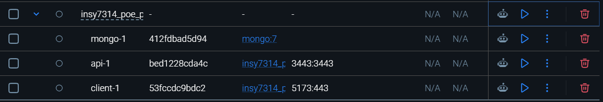

Stop the containers with `docker compose down` (add `-v` to also delete the MongoDB data volume).

#### Creating an admin account in Docker
MongoDB has no published port in Docker, so the role is changed from inside the `mongo` container. Register a normal account at `https://localhost:5173`, then open a Mongo shell from the folder containing `docker-compose.yml`. Replace `hustlehub` after `-u` with your `MONGO_USER` if it differs; the shell prompts for `MONGO_PASSWORD`:

```bash
docker compose exec mongo mongosh -u hustlehub -p --authenticationDatabase admin hustlehub
```

At the `hustlehub>` prompt, change the role of the account you registered, then type `exit`:

```js
db.users.updateOne({ email: "admin@example.com" }, { $set: { role: "admin" } })
```

The result should show `modifiedCount: 1`. Emails are stored in lowercase, so `matchedCount: 0` means the email does not match. Log in again and the admin dashboard is shown. The account is kept in the MongoDB data volume, so it survives `docker compose down` but not `docker compose down -v`.

## Testing

### Postman / Newman
The Part 2 collection ([API/postman/HustleHub+ Part2.postman_collection.json](API/postman/HustleHub+%20Part2.postman_collection.json)) runs **109 requests / 168 assertions** across ten folders:

- **00 Health, 01 Auth, 05 Account** - register, login, `/me`, profile and password changes, with their `400`/`401`/`409` failure paths.
- **02 Gigs, 03 Bookings, 04 Income** - the domain flows, including validation failures, ownership checks, review rules and the freelancer-only income summary.
- **06 Error handling** - unknown route (`404`), malformed JSON (`400`), body over 10&nbsp;KB (`413`), each asserting the controlled error message so nothing internal leaks.
- **07 Users - access control, 08 Admin** - role checks (`403`); the admin folder is skipped unless `adminEmail`/`adminPassword` are set, which leaves 99 requests / 151 assertions (this is what CI runs).
- **09 Rate limiting** - runs last and asserts the `429` response, its message and the rate-limit headers on both the booking and the login endpoint.

The Part 1 collection (13 requests / 17 assertions) is kept beside it and runs with `npm run test:api:part1`.

Run it headless with Newman [37]:

```bash
cd API
npm run test:api
```

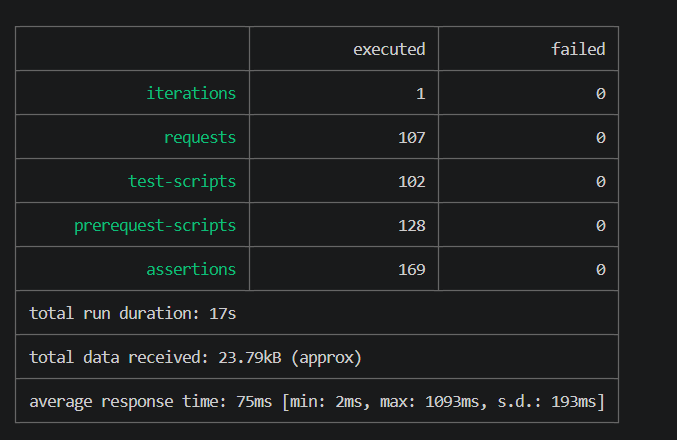

The run above is without the admin credentials set, so the admin folder is skipped: **99/99 requests, 151/151 assertions, 0 failures**.

A captured run is committed at [API/postman/newman/newman-run.txt](API/postman/newman/newman-run.txt) (JSON export beside it): **109/109 requests, 168/168 assertions, 0 failures**, with the admin folder included. `EXPOSE_TOKEN_IN_BODY=true` must be set (see the `.env` above) so the tests can read the token from the response body. The rate limiters are counted per API process and the collection uses up part of their allowance, so restart the API before each run. Screenshots of the saved response examples are in [the accompanying PDF](Screenshots/HustleHub+%20Postman%20Collection%20Screenshots%20for%20Part%202.pdf).

### npm audit
`npm audit` checks every dependency against the public vulnerability database [38]. The API has **0 known vulnerabilities**:

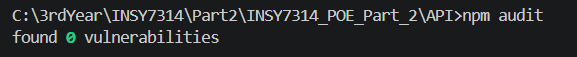

The CI pipeline runs `npm audit --audit-level=high` on every push, so a dependency with a high-severity vulnerability fails the build.

### OWASP ZAP
The running API was scanned with the OWASP ZAP baseline scan, which crawls the target and passively checks every response for missing security headers, insecure cookies, information leaks and similar weaknesses [39]. The scan plan is [zap.yaml](zap.yaml) and the full report is [zap-report.html](zap-report.html).

```bash
docker run --rm -v "${PWD}:/zap/wrk/:rw" -t ghcr.io/zaproxy/zaproxy:stable zap-baseline.py -t https://host.docker.internal:3443 -r zap-report.html
```

**Result: 66 checks passed, 0 failed. No high, medium or low risk alerts.**

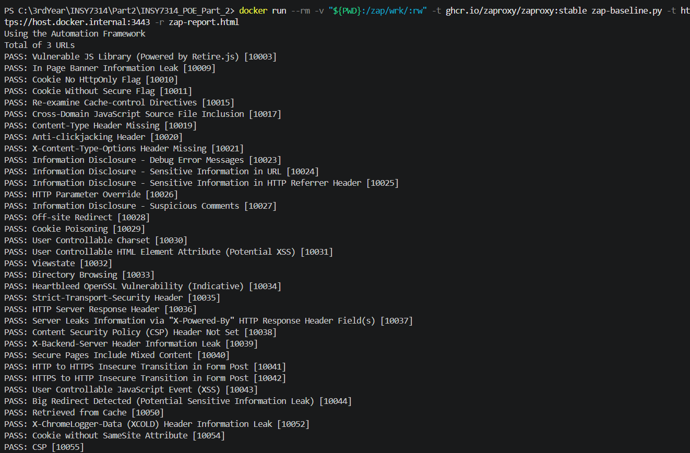
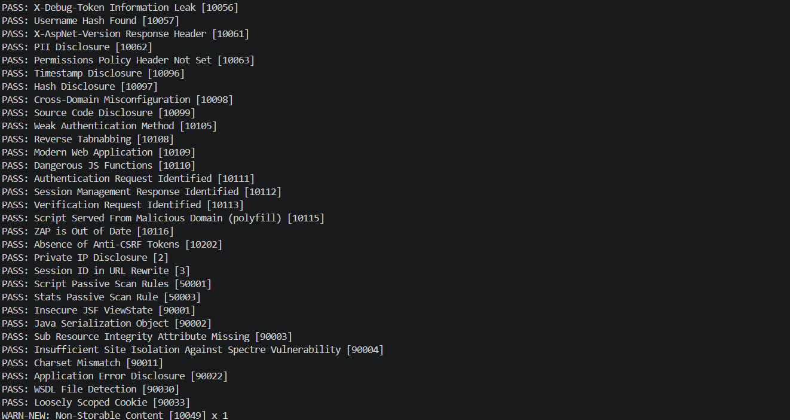
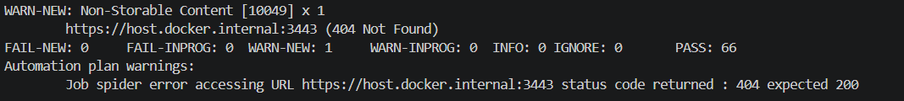

The single informational notice, *Non-Storable Content*, is intended: it reports that responses carry `Cache-Control: no-store`, which is set on purpose so that personal and financial data is never cached. The spider warning about a `404` is also expected, because the API has no page at `/`.

The baseline scan is passive and unauthenticated, so it covers the public surface of the API. The authenticated routes are covered by the Postman collection above.

### Backend self-checks
The pure logic in the API has assert-based self-checks that need no server or database:

| Command | What it checks |
|---------|----------------|
| `npm run test:auth` | reading the token from the cookie or header; rejecting tokens issued before a password change |
| `npm run test:gigs` | gig ownership and delete rules; gig validation, including an injected owner or query operator |
| `npm run test:bookings` | allowed status changes per role; who counts as a party to a booking; booking, status and review validation |
| `npm run test:income` | income totals, tax estimate and `TAX_RATE` validation |
| `npm run test:sanitize` | HTML stripping, including nested tags |

```bash
cd API
npm run test:auth
```

### Frontend tests
The React app is tested with [Vitest](https://vitest.dev/) (the Vite-native test runner, using the same `describe` / `it` / `expect` / mock style as Jest) [40] and React Testing Library [41], which renders components in a simulated browser (jsdom) and interacts with them the way a user does. The API client is mocked, so no backend or database is needed.

```bash
cd frontend
npm install
npm run test:run
```

`npm test` runs the same tests in watch mode. A captured run is committed at [frontend/test-results/vitest-run.txt](frontend/test-results/vitest-run.txt): **7 test files, 46 tests, 0 failures**. The CI pipeline runs `npm run test:run` in the frontend job, so a failing test fails the build.

| Test file | What it checks |
|-----------|----------------|
| `LoginForm.test.jsx` | renders; trimmed credentials sent; API error shown and password cleared; cooldown after a `429`; switch to register |
| `RegisterForm.test.jsx` | renders; weak password, bad email and a script-like name are rejected before any API call; valid sign-up defaults to `client`; duplicate-email error shown |
| `PasswordStrength.test.jsx` | strength meter label for each level |
| `Dashboard.test.jsx` | role-based navigation: client, freelancer and admin each see only their own tabs, and an admin triggers no gig or booking requests |
| `AdminUsers.test.jsx` | user list, role filter and search; detail page; delete only after confirmation; refused deletes shown; no delete option for your own account |
| `password.test.js` | password rule: accepted case plus too short, missing upper/lower/number, too long |
| `api.test.js` | `4xx` messages shown; `429` friendly message; `5xx` never leaks server internals; `401` on a protected route signs the user out |

## CI Pipeline
[.github/workflows/ci.yml](.github/workflows/ci.yml) runs on every push and pull request using GitHub Actions [42].

| Job | Steps |
|-----|-------|
| **backend-test** | install from the lockfile; syntax check of every JavaScript file; `npm audit` at high severity; the five self-checks; then start the real API over HTTPS against a MongoDB service container and run the full Newman collection |
| **frontend-build** | install from the lockfile; lint with Oxlint; run the Vitest tests; production build |
| **deploy** | runs only on `main`, and only after both jobs pass. It is a placeholder for now; the real deployment step is planned for Part 3 |

A failing check, test or audit in either job fails the build.

## Screenshots

The screenshots below follow one booking through the application, from sign-in to the freelancer's earnings. The image files are in [Screenshots](Screenshots).

### Sign in and registration
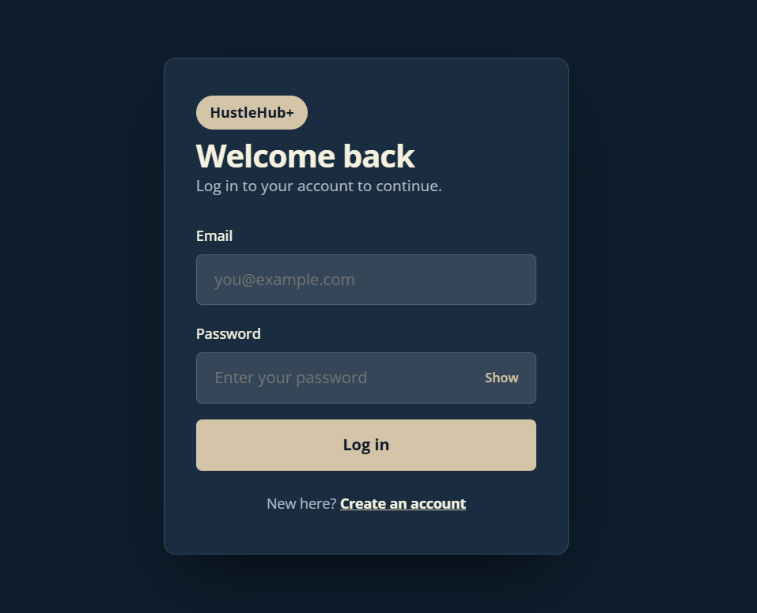

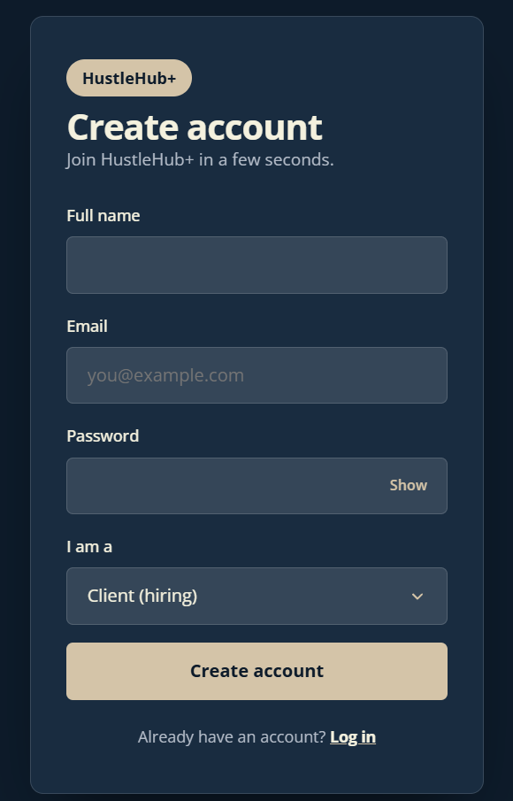

### Freelancer - managing gigs
A freelancer creates, edits, pauses and deletes their own listings.

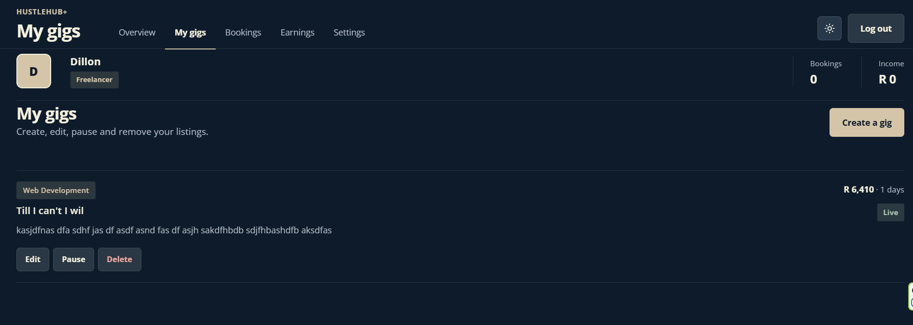

### Client - browsing and booking
A client searches and filters the available gigs, then books one. The price shown comes from the gig and cannot be changed by the client.

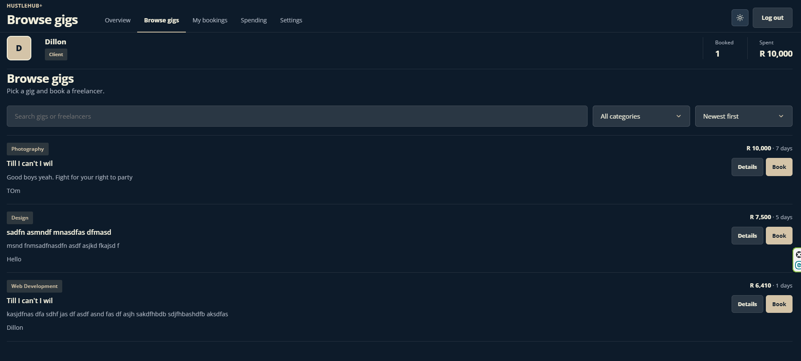

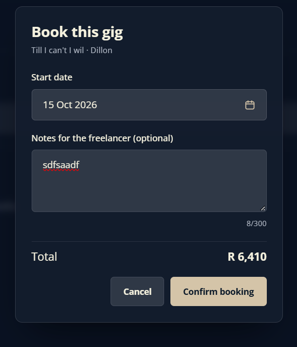

Every booking creates a transaction record with its own `TX-` reference. The confirmation shows it straight away and states that the payment is simulated.

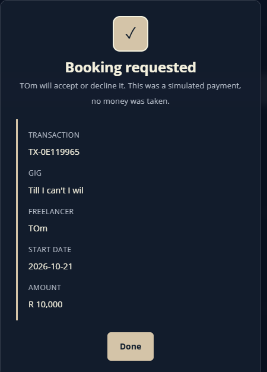

The same reference is shown next to the booking.

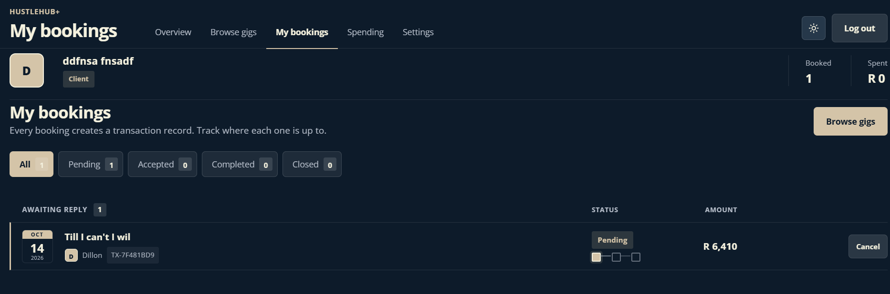

### Freelancer - bookings and income
The freelancer accepts the booking and marks it complete. The same transaction reference appears on their side.

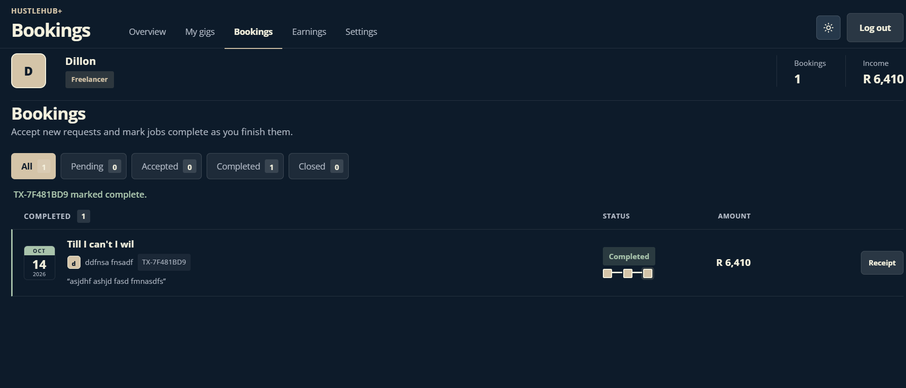

Once the booking is complete the client can review it, and the rating and comment appear on the freelancer's booking.

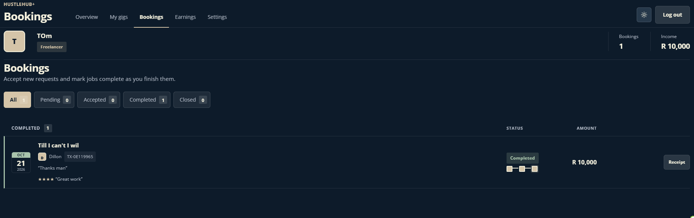

The income from that booking is added to the freelancer's earnings, with the estimated tax.


### Client - overview, spending and receipts
The client's overview summarises their bookings and total spent.

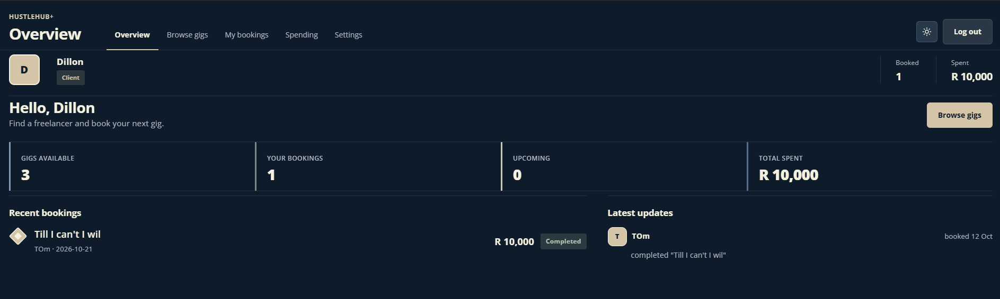

The Spending tab breaks the total down by month and by category and lists each transaction. Pending and cancelled bookings are not counted.

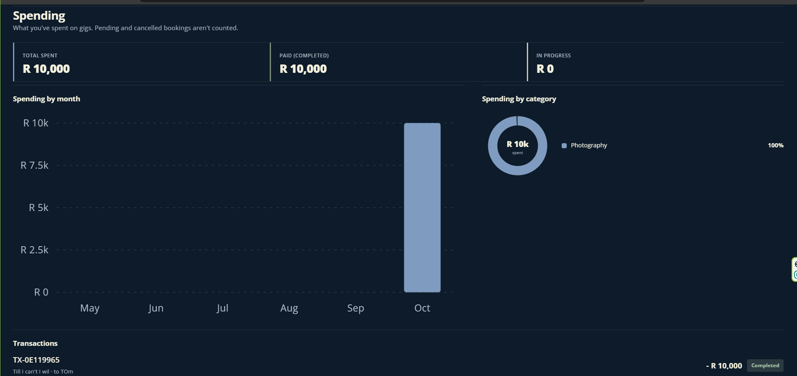

Either party can open the receipt for a booking, which can be printed or saved as a PDF.

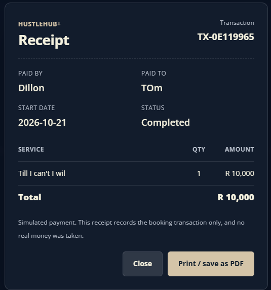

### Settings
Every role can change their display name and password. Email and role cannot be changed, and changing the password signs out every other session.

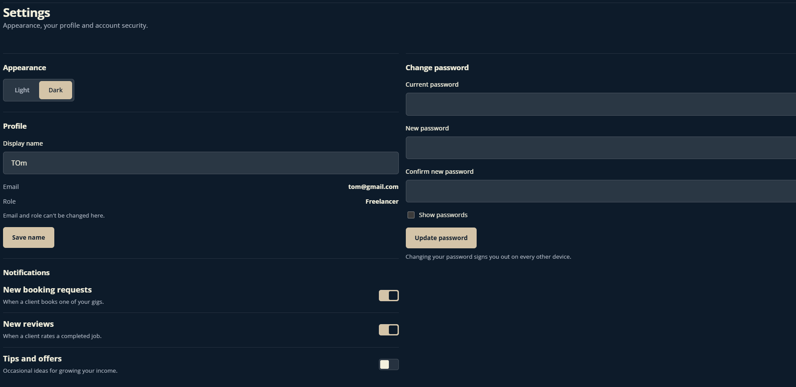

## Demonstration Video

Youtube Video Link: https://youtu.be/LDcBwhAfzEg

## References

- [1] 	Vite, "Getting Started," Vite Guide, 2026. [Online]. Available: https://vite.dev/guide/. [Accessed 11 October 2026].
- [2] 	Bitwarden, "What is password hashing?," 2026. [Online]. Available: https://bitwarden.com/resources/what-is-password-hashing/. [Accessed 3 September 2026].
- [3] 	OWASP Foundation, "Password Storage Cheat Sheet," OWASP Cheat Sheet Series, 2024. [Online]. Available: https://cheatsheetseries.owasp.org/cheatsheets/Password_Storage_Cheat_Sheet.html. [Accessed 5 September 2026].
- [4] 	S. Saha, "The JSON Web Token Handbook: Learn to Use JWTs for Web Authentication," Hashnode, 8 October 2025. [Online]. Available: https://www.freecodecamp.org/news/the-json-web-token-handbook-learn-to-use-jwts-for-web-authentication/. [Accessed 3 September 2026].
- [5] 	M. Jones, J. Bradley and N. Sakimura, "JSON Web Token (JWT)," RFC 7519, Internet Engineering Task Force, May 2015. [Online]. Available: https://www.rfc-editor.org/rfc/rfc7519. [Accessed 5 September 2026].
- [6] 	OWASP Foundation, "JSON Web Token for Java Cheat Sheet," OWASP Cheat Sheet Series, 2024. [Online]. Available: https://cheatsheetseries.owasp.org/cheatsheets/JSON_Web_Token_for_Java_Cheat_Sheet.html. [Accessed 5 September 2026].
- [7] 	OWASP Foundation, "Session Management Cheat Sheet," OWASP Cheat Sheet Series, 2024. [Online]. Available: https://cheatsheetseries.owasp.org/cheatsheets/Session_Management_Cheat_Sheet.html. [Accessed 5 September 2026].
- [8] 	P. A. Grassi, J. L. Fenton, E. M. Newton et al., "Digital Identity Guidelines: Authentication and Lifecycle Management," NIST Special Publication 800-63B, National Institute of Standards and Technology, June 2017. [Online]. Available: https://pages.nist.gov/800-63-3/sp800-63b.html. [Accessed 5 September 2026].
- [9] 	A. Barth, "HTTP State Management Mechanism," RFC 6265, Internet Engineering Task Force, April 2011. [Online]. Available: https://www.rfc-editor.org/rfc/rfc6265. [Accessed 5 September 2026].
- [10] 	OWASP Foundation, "Cross-Site Request Forgery Prevention Cheat Sheet," OWASP Cheat Sheet Series, 2024. [Online]. Available: https://cheatsheetseries.owasp.org/cheatsheets/Cross-Site_Request_Forgery_Prevention_Cheat_Sheet.html. [Accessed 5 September 2026].
- [11] 	OWASP Foundation, "Authorization Cheat Sheet," OWASP Cheat Sheet Series, 2024. [Online]. Available: https://cheatsheetseries.owasp.org/cheatsheets/Authorization_Cheat_Sheet.html. [Accessed 11 October 2026].
- [12] 	OWASP Foundation, "OWASP Top 10:2021," OWASP Foundation, 2021. [Online]. Available: https://owasp.org/Top10/. [Accessed 5 September 2026].
- [13] 	Mozilla, "Cross-Origin Resource Sharing (CORS)," MDN Web Docs, 2026. [Online]. Available: https://developer.mozilla.org/en-US/docs/Web/HTTP/CORS. [Accessed 5 September 2026].
- [14] 	Helmet.js, "Helmet — Help secure Express apps with various HTTP headers," 2025. [Online]. Available: https://helmetjs.github.io/. [Accessed 5 September 2026].
- [15] 	Mozilla, "Content-Security-Policy," MDN Web Docs, 2026. [Online]. Available: https://developer.mozilla.org/en-US/docs/Web/HTTP/Headers/Content-Security-Policy. [Accessed 5 September 2026].
- [16] 	J. Hodges, C. Jackson and A. Barth, "HTTP Strict Transport Security (HSTS)," RFC 6797, Internet Engineering Task Force, November 2012. [Online]. Available: https://www.rfc-editor.org/rfc/rfc6797. [Accessed 5 September 2026].
- [17] 	OWASP Foundation, "HTTP Headers Cheat Sheet," OWASP Cheat Sheet Series, 2024. [Online]. Available: https://cheatsheetseries.owasp.org/cheatsheets/HTTP_Headers_Cheat_Sheet.html. [Accessed 11 October 2026].
- [18] 	nginx, "Configuring HTTPS servers," nginx Documentation, 2026. [Online]. Available: https://nginx.org/en/docs/http/configuring_https_servers.html. [Accessed 11 October 2026].
- [19] 	OWASP Foundation, "Blocking Brute Force Attacks," OWASP Foundation, 2023. [Online]. Available: https://owasp.org/www-community/controls/Blocking_Brute_Force_Attacks. [Accessed 5 September 2026].
- [20] 	express-rate-limit, "express-rate-limit — Basic rate-limiting middleware for Express," npm, 2025. [Online]. Available: https://www.npmjs.com/package/express-rate-limit. [Accessed 5 September 2026].
- [21] 	OWASP Foundation, "Input Validation Cheat Sheet," OWASP Cheat Sheet Series, 2024. [Online]. Available: https://cheatsheetseries.owasp.org/cheatsheets/Input_Validation_Cheat_Sheet.html. [Accessed 5 September 2026].
- [22] 	OWASP Foundation, "Mass Assignment Cheat Sheet," OWASP Cheat Sheet Series, 2024. [Online]. Available: https://cheatsheetseries.owasp.org/cheatsheets/Mass_Assignment_Cheat_Sheet.html. [Accessed 11 October 2026].
- [23] 	Mongoose, "Validation," Mongoose Documentation, 2026. [Online]. Available: https://mongoosejs.com/docs/validation.html. [Accessed 11 October 2026].
- [24] 	OWASP Foundation, "REST Security Cheat Sheet," OWASP Cheat Sheet Series, 2024. [Online]. Available: https://cheatsheetseries.owasp.org/cheatsheets/REST_Security_Cheat_Sheet.html. [Accessed 5 September 2026].
- [25] 	fiznool, "express-mongo-sanitize — Sanitize your express payload to prevent MongoDB operator injection," GitHub, 2026. [Online]. Available: https://github.com/fiznool/express-mongo-sanitize. [Accessed 11 October 2026].
- [26] 	OWASP Foundation, "Testing for NoSQL Injection," OWASP Web Security Testing Guide, 2026. [Online]. Available: https://owasp.org/www-project-web-security-testing-guide/latest/4-Web_Application_Security_Testing/07-Input_Validation_Testing/05.6-Testing_for_NoSQL_Injection. [Accessed 11 October 2026].
- [27] 	analog-nico, "hpp — Express middleware to protect against HTTP Parameter Pollution attacks," GitHub, 2026. [Online]. Available: https://github.com/analog-nico/hpp. [Accessed 11 October 2026].
- [28] 	React, "Common components," React Reference, 2026. [Online]. Available: https://react.dev/reference/react-dom/components/common. [Accessed 11 October 2026].
- [29] 	OWASP Foundation, "Cross Site Scripting Prevention Cheat Sheet," OWASP Cheat Sheet Series, 2024. [Online]. Available: https://cheatsheetseries.owasp.org/cheatsheets/Cross_Site_Scripting_Prevention_Cheat_Sheet.html. [Accessed 11 October 2026].
- [30] 	E. Rescorla, "The Transport Layer Security (TLS) Protocol Version 1.3," RFC 8446, Internet Engineering Task Force, August 2018. [Online]. Available: https://www.rfc-editor.org/rfc/rfc8446. [Accessed 5 September 2026].
- [31] 	OWASP Foundation, "Transport Layer Security Cheat Sheet," OWASP Cheat Sheet Series, 2024. [Online]. Available: https://cheatsheetseries.owasp.org/cheatsheets/Transport_Layer_Security_Cheat_Sheet.html. [Accessed 5 September 2026].
- [32] 	OWASP Foundation, "Error Handling Cheat Sheet," OWASP Cheat Sheet Series, 2024. [Online]. Available: https://cheatsheetseries.owasp.org/cheatsheets/Error_Handling_Cheat_Sheet.html. [Accessed 5 September 2026].
- [33] 	Docker, "Networking in Compose," Docker Docs, 2026. [Online]. Available: https://docs.docker.com/compose/how-tos/networking/. [Accessed 11 October 2026].
- [34] 	MongoDB, "Security Checklist for Self-Managed Deployments," MongoDB Database Manual, 2026. [Online]. Available: https://www.mongodb.com/docs/manual/administration/security-checklist/. [Accessed 11 October 2026].
- [35] 	OWASP Foundation, "Docker Security Cheat Sheet," OWASP Cheat Sheet Series, 2024. [Online]. Available: https://cheatsheetseries.owasp.org/cheatsheets/Docker_Security_Cheat_Sheet.html. [Accessed 11 October 2026].
- [36] 	Docker, "Multi-stage builds," Docker Docs, 2026. [Online]. Available: https://docs.docker.com/build/building/multi-stage/. [Accessed 11 October 2026].
- [37] 	Postman, "Run and test collections from the command line using Newman CLI," Postman Docs, 2026. [Online]. Available: https://learning.postman.com/docs/collections/using-newman-cli/command-line-integration-with-newman/. [Accessed 11 October 2026].
- [38] 	npm, "npm-audit," npm Docs, 2026. [Online]. Available: https://docs.npmjs.com/cli/v11/commands/npm-audit. [Accessed 11 October 2026].
- [39] 	ZAP, "ZAP - Baseline Scan," ZAP Documentation, 2026. [Online]. Available: https://www.zaproxy.org/docs/docker/baseline-scan/. [Accessed 11 October 2026].
- [40] 	Vitest, "Getting Started," Vitest Guide, 2026. [Online]. Available: https://vitest.dev/guide/. [Accessed 11 October 2026].
- [41] 	Testing Library, "React Testing Library," Testing Library Docs, 2026. [Online]. Available: https://testing-library.com/docs/react-testing-library/intro/. [Accessed 11 October 2026].
- [42] 	GitHub, "GitHub Actions documentation," GitHub Docs, 2026. [Online]. Available: https://docs.github.com/en/actions. [Accessed 11 October 2026].
