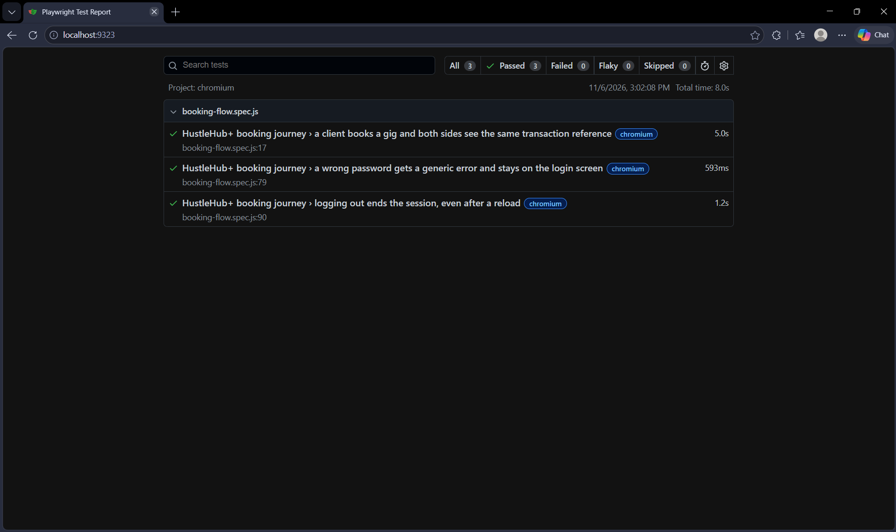

# HustleHub+ Frontend

The React single-page app for HustleHub+, built with Vite. It gives clients, freelancers and admins their own dashboard and talks to the API in [`../API`](../API). The full project documentation, including the security decisions, is in the [main README](../README.md).

## Requirements

- Node.js 22+ (needed by the tests; the app itself runs on 20+)
- The API running on `https://localhost:3443`, with its certificate in `../API/certs` - the dev server reuses it, so complete the API setup first

## Running

```bash
npm install
npm run dev
```

The app is served at `https://localhost:5173`. The browser warns about the self-signed certificate; open `https://localhost:3443/health` once and accept it there too, otherwise requests to the API are blocked.

An optional `.env` file in this folder can set:

| Variable | Default | Purpose |
|----------|---------|---------|
| `VITE_API_URL` | `https://localhost:3443` | Where the API is |
| `VITE_IDLE_MINUTES` | `15` | Minutes of inactivity before the user is signed out |

## Scripts

| Command | What it does |
|---------|--------------|
| `npm run dev` | Dev server over HTTPS with hot reload |
| `npm run build` | Production build into `dist/` |
| `npm run preview` | Serves the production build with the strict Content-Security-Policy |
| `npm run lint` | Lints with Oxlint |
| `npm test` | Vitest in watch mode |
| `npm run test:run` | Runs the tests once (used by CI) |

A captured test run is in [test-results/vitest-run.txt](test-results/vitest-run.txt).

## End-to-end tests
Vitest checks components in isolation with the API mocked. The end-to-end suite checks the whole path: a real browser drives the built React app, served by the nginx container over HTTPS, which calls the real API and MongoDB in the Compose stack. It uses [Playwright](https://playwright.dev/) with Chromium. The specs are in [frontend/e2e/](frontend/e2e/) and the settings in [frontend/playwright.config.js](frontend/playwright.config.js).

| Test | What it checks |
|------|----------------|
| `a client books a gig and both sides see the same transaction reference` | a freelancer registers and publishes a gig; a client registers, finds it and books it; the receipt shows a `TX-` reference in the format the API generates; after a page reload the client's booking list shows the same reference (so it was stored, not just displayed); the freelancer logs in through the login form, sees the request, accepts it and the receipt shows the same reference |
| `a wrong password gets a generic error and stays on the login screen` | the API's `Invalid email or password.` message is shown, the password field is cleared and no dashboard appears |
| `logging out ends the session, even after a reload` | the login screen is shown after a reload and the API treats the next request as anonymous (`401`) |

Run it against the running stack:

```bash
docker compose up -d --build
cd frontend
npm ci
npx playwright install chromium
npm run test:e2e
npx playwright show-report      # HTML report with a screenshot per step
```

The API's rate limiters are counted per process (login 5 per 15 minutes, registration 10), and one run uses 2 logins and 3 registrations, so run `docker compose restart api` before running the suite again. Every run creates fresh accounts with random e-mail addresses and passwords, so it never depends on earlier data. The suite writes its own output to `frontend/e2e-results/` and `frontend/playwright-report/`, not to `frontend/test-results/`, which holds the committed Vitest run.

In CI the **e2e** job builds the images, starts the Compose stack with throwaway secrets, runs the suite and uploads the `playwright-report` artifact (HTML report, screenshots and, for a failure, a trace). It has its own stack, separate from **docker-zap**, because the ZAP active scan uses up the same per-IP rate limits. A failing test fails the build and blocks **deploy**.



## Structure

```
src/
├── App.jsx                # Session restore, login/register switch
├── services/api.js        # API client (cookie auth, safe error messages)
├── hooks/useIdleLogout.js # Inactivity timeout
├── components/            # Forms, dashboard shell, dialogs, charts
├── screens/               # One screen per dashboard tab
└── utils/                 # Password rule, month helpers
```

## Docker

[Dockerfile](Dockerfile) is a multi-stage build: the app is built with Node, then served by nginx over HTTPS using [nginx.conf.template](nginx.conf.template). It is started with the rest of the stack from the repository root - see the [main README](../README.md#docker).
